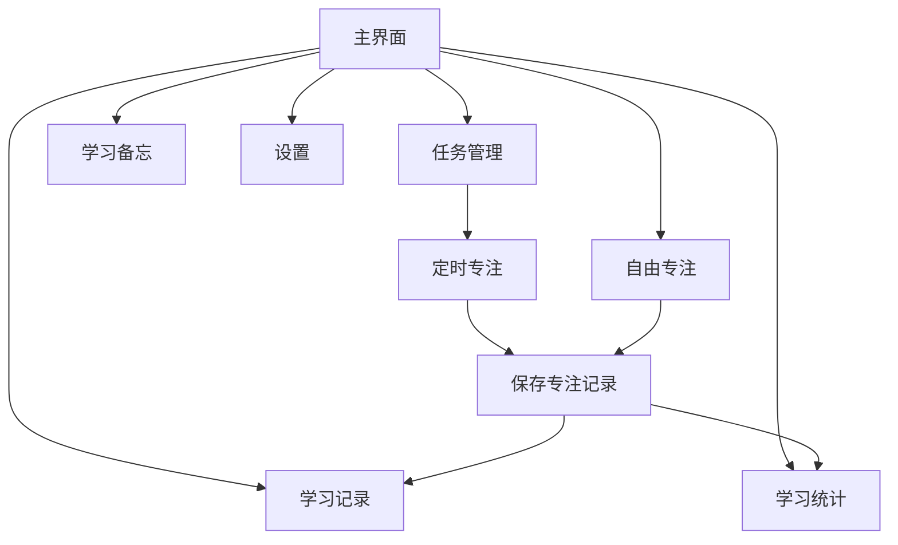

# 专注学习助手（LearningHelper）

一款使用 Java 开发的 Android 学习辅助应用，集任务管理、专注计时、背景音频、学习备忘和学习统计于一体。项目结合 Android 四大组件实现，适合课程作业与学习实践。

## 功能介绍

| 功能 | 说明 |
| --- | --- |
| 学习任务 | 新建、编辑、删除任务，标记完成，按完成状态筛选 |
| 定时专注 | 支持 10 秒、30 秒、15 / 25 / 45 / 60 分钟，使用圆形计时界面 |
| 自由专注 | 无需创建任务即可开始正计时，结束后保存学习记录 |
| 背景音频 | 提供雨声、海浪、森林音效；自由专注支持选择本地音频播放 |
| 学习备忘 | 独立入口，记录作业与学习事项，支持保存、查看和删除 |
| 学习记录 | 按日期分组展示专注记录、时间与状态，支持逐条删除 |
| 学习统计 | 展示今日及累计专注情况，分别展示自由专注和定时专注时长 |
| 设置 | 设置默认专注时长、背景声音及通知相关选项 |

## 页面关系

## 技术与四大组件

采用 **Java + Android Views + SQLite + SharedPreferences**，无需登录或配置服务器。

| 组件 | 项目中的实现 | 用途 |
| --- | --- | --- |
| Activity | `MainActivity`、`FocusActivity`、`FreeFocusActivity` 等 | 展示页面并处理用户操作 |
| Service | `NoiseService` | 通过前台服务播放背景音频 |
| BroadcastReceiver | `FocusAlarmReceiver`、`NoiseActionReceiver` | 接收计时提醒及音频通知操作 |
| ContentProvider | `TaskProvider` | 封装本地数据库，统一访问任务与专注记录 |

## 运行方法

1. 下载仓库，在 Android Studio 中打开本项目目录（包含 `settings.gradle` 的文件夹）。
2. 等待 Gradle 同步完成，按提示安装所需 Android SDK。当前配置为 **compileSdk / targetSdk 37**，Gradle **9.6.0**，Android Gradle Plugin **9.4.1**；需使用支持这些版本的 Android Studio 和兼容 JDK。
3. 创建模拟器或连接 Android 手机，选择 `app` 并点击 **Run ▶**。建议使用 **Android 8.0（API 26）及以上**设备；项目声明的 minSdk 为 24，但部分功能使用了 API 26 接口。
4. 首次使用时允许通知权限，以便显示专注提醒与音频播放通知。选择本地音乐时，通过系统文件选择器授权访问音频。

> Java 源码语言级别为 11，不代表 Gradle 运行环境必须使用 JDK 11。`local.properties` 中的 SDK 路径由本机配置生成，不应提交到仓库。

## 数据说明

- 任务与专注记录保存在本地 SQLite；学习备忘和偏好设置使用 SharedPreferences，无云端同步功能。
- 学习统计页将**完成的定时专注**与**手动结束并保存的自由专注**计入时长；提前结束或中断的定时专注不计入有效时长。
- 音效文件位于 `app/src/main/res/raw/`；主要 Java 代码位于 `app/src/main/java/com/example/learninghelper/`。

